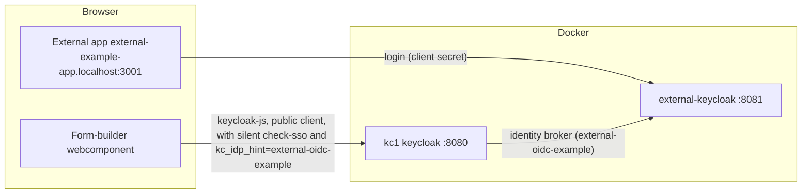

# vue-json-forms-builder-external-example

A minimal Nuxt app that demonstrates how to integrate the form-builder webcomponent into a third-party app with a different OIDc provider than the main app (vue-json-forms-builder). It runs on its **own domain** (`external-example-app.localhost`) so cookie/session isolation between the
apps can be tested in one browser (unlike `localhost` ports, cookies are not shared across different hosts).

For an overview of the concepts before going into details, see [docs/auth/README.md](../../apps/vue-json-forms-builder/docs/auth/README.md#auth-integration-with-external-oidc-provider).

- The app logs in against an **external Keycloak** (`external-keycloak`, service `external-keycloak` in `../vue-json-forms-builder/docker-compose.yaml`) with a **confidential client** (`external-example-app`, client secret).
- After login there is a basic dashboard with a shared input field for a **numeric form ID or form path**.
- The [`<vue-json-form-builder>`](../../packages/vue-json-forms-builder-webcomponent) loads the selected form over the collaboration websocket (Hocuspocus). The **Vue JSON Form** tab fetches the same form's JSON and UI schemas from `GET /api/v1/forms/{id}/schema/artifacts` and passes both artifacts to editable and read-only form examples.
- Both cross-origin API calls use the main app's Keycloak (`kc1`) public client `vueformbuilder-embed` and a bearer token. The artifact endpoint is **not public**: it requires authentication and form view permission. `NUXT_CORS_EMBED_ORIGINS` controls cross-origin bundle loads and bearer-authenticated `/api/v1` requests without cookies. Session-cookie API requests remain restricted to `NUXT_AUTH_ALLOWED_REDIRECT_ORIGINS`.

## Prerequisites

1. Docker services running: `cd ../vue-json-forms-builder && docker compose up -d` (postgres, kc1, external-keycloak). (**Note:** The federation between kc1 and the external Keycloak is already configured in the imported realm files (`keycloak/dev/dev-realm.json`, `keycloak/external/dev-realm.json`)).
2. Start the main app with `cd ../vue-json-forms-builder && yarn dev` (port 3000). Before startup, set `NUXT_AUTH_ALLOWED_CLIENT_IDS=vueformbuilder,vueformbuilder-embed` in its active `.env` or process environment so the API and collaboration server accept the embed client's kc1 bearer token. `NUXT_CORS_EMBED_ORIGINS` controls browser origins allowed to load bundles and make bearer API requests; it defaults to `*`, or can be a comma-separated list of exact origins such as `http://external-example-app.localhost:3001`. `NUXT_AUTH_ALLOWED_REDIRECT_ORIGINS` is used separately for session-cookie API calls and login redirects. Values in `example.env` are only a template and are not loaded automatically.
3. The backend serves both webcomponents' assets through Nitro's normal `publicAssets` handling under `http://localhost:3000/webcomponent/`: the builder script is `/webcomponent/vue-json-form-builder.js`, while Vue JSON Form uses `/webcomponent/vue-json-form.mjs` and `/webcomponent/vue-json-form.css`. `NUXT_CORS_EMBED_ORIGINS` controls CORS for these bundles and bearer-authenticated `/api/v1` requests without credentialed cookies. Leave it unset or set it to `*` to allow all origins, or set a comma-separated list of exact origins (scheme, hostname and optional port; no paths or trailing slashes) to restrict them. An explicitly empty value allows no cross-origin embeds. Restart the backend after changing it. API preflights are answered by the server plugin and allow `Authorization`. Session-based API requests still require an exact origin allowlist. The reverse proxy must not add CORS headers. CORS does not stop non-browser clients from downloading the bundle or calling the API; authentication and form permissions still apply. Keycloak redirect URIs and web origins must also permit the embedding application.

## Domains

All apps use `.localhost` domains (which browsers resolve to `127.0.0.1` without hosts-file entries):

| App                    | URL                                          |
| ---------------------- | -------------------------------------------- |
| Main builder backend   | `http://localhost:3000` (kc1, port 8080)     |
| This external demo app | `http://external-example-app.localhost:3001` |
| External Keycloak      | `http://external-keycloak.localhost:8081`    |

**Note:** Cookies are per-host: this app's session (`external-app-session` on `external-example-app.localhost`), the external Keycloak's SSO cookie and the main backend's session (`nuxt-session` on `localhost`) never collide, even in the same browser.

## What to expect

1. Open **http://external-example-app.localhost:3001** — landing page with a _Login_ button.
1. Click _Login_ → you are taken to the external Keycloak and logged in (create a test user there first if none exists).
1. You land on the dashboard: _Hello, \<user\>!_
1. Enter a **numeric ID or form path** and press **Load form**. Both tabs use this selection. The builder connects to the collaboration document; the Vue JSON Form tab fetches `GET /api/v1/forms/{id}/schema/artifacts` using the kc1 bearer token and renders the returned JSON and UI schemas in editable and disabled-fieldset examples. The artifact API requires the user to have view permission. The shared builder resolves paths to the canonical numeric form ID before connecting. It runs keycloak-js against kc1 (`http://kc1.localhost:8080`, realm `dev`, public client `vueformbuilder-embed`):
    - silent `check-sso` (hidden iframe) → a kc1 session exists → the access token is obtained **without any navigation** and the builder connects straight away.
    - no kc1 session → the builder shows a **Sign in** button; clicking it navigates to kc1, which — thanks to `kc_idp_hint=external-oidc-example` and the existing external SSO session — authenticates the user **without a credential prompt** and redirects back to this page.
    - the silent check-sso iframe is limited in browsers with strict tracking protection (Safari/Firefox): the Sign in button appears even for logged-in users there — the click then does the top-level redirect.
1. The builder connects to the collab websocket (`ws://localhost:1234`, document name = form id) with the kc1 access token as `Authorization: Bearer` (validated by the backend via JWKS, `NUXT_AUTH_ALLOWED_CLIENT_IDS`) and Hocuspocus hydrates the form from its stored definition.
1. Loading another form id re-mounts the builder with the new document.
1. _Logout_ clears the local external session (the kc1/external Keycloak sessions stay intact).
